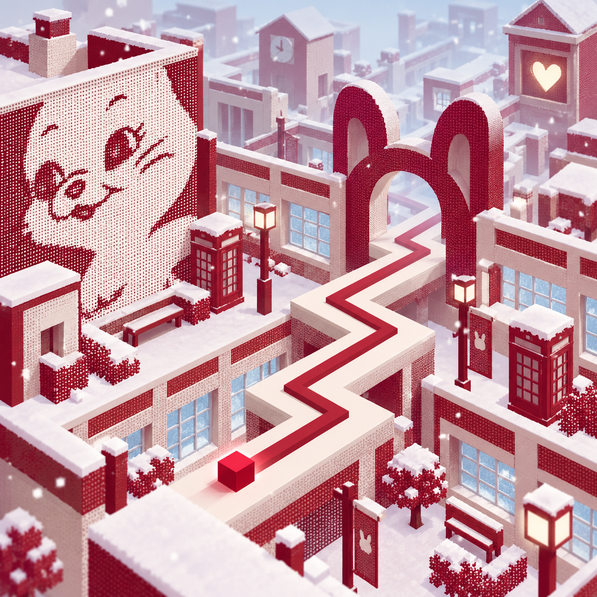

# 跳舞的线 · NewJeans：定稿设计

**设计冻结：2026-10-18。** 先完成下述方向，再继续 Babylon.js 实现。曲序保持用户的 16 首列表；Get Up 是第 11 首间奏，连接 Cool With You 与 ASAP。以下地图和小彩蛋是本项目的原创演绎；歌曲背景依据分别见 [前八首研究](research-early.md) 与 [后八首研究](research-later.md)。

## 共同的游戏语言

采用《跳舞的线》早期移动版的简洁结构：整个屏幕是一幅可玩的立体风景，选关文字、三个皇冠、十枚钻石与开始按钮克制地浮在场景上。游戏中收起大部分界面，用连续直角路、细线和方块作为视觉中心。路线与音乐共同推动故事，不另加剧情弹窗。

每首歌包含四个视觉段落、一个可识别的专属地标和两枚微小背景彩蛋；Get Up 保留一枚。场景沿路线形成有意安排的地点，不随机撒相同方块。同专辑共享材料与颜色，每首的构图、物件和变化不同。

道路周围至少留出一个路宽的净空；高物体放在镜头远侧。转弯前 1.5–2.5 秒的道路保持可见，彩蛋只在长直段或画面外围出现。没有假岔路、突然熄灭的路面、全屏闪光或挡住玩家的粒子。镜头缓慢跟随和小幅拉远，任何旋转都不能改变点击判断。

## 五套专辑视觉

| 家族 | 核心色 | 质感与图形 | 关卡覆盖 |
| --- | --- | --- | --- |
| 丹宁蓝图 Denim | 钴蓝 `#244EBB`、乳白 `#F6F4EA`、水洗蓝 `#AFCBEB` | 网点印刷只放侧面和远景；兔耳、唱片、磁带窗、蓝白建筑 | Attention / Hype Boy / Cookie / Hurt |
| 红色记忆 Memory | 酒红 `#A92E48`、纸白 `#F6F0E8`、雾蓝 `#BECEDC` | 红白纸片、窗框、信件、录像带；OMG 活泼，Ditto 安静 | OMG / Ditto |
| 像素日梦 Pixel | 天蓝 `#AADCF5`、薄荷 `#A3E8C3`、粉 `#F18BC8`、淡紫 `#BBA3EE` | 3D 体素、像素星、游戏窗口、五色尾迹；安静歌曲降低饱和度和密度 | New Jeans / Super Shy / ETA / Cool With You / Get Up / ASAP |
| 夏日唱片 Mixtape | 珊瑚 `#D46E56`、奶油 `#F5E8BA`、墨蓝 `#243B51`、水洗绿 `#91AC97` | 黑胶、磁带、方砖、遮阳棚、胶片框、街道和海风 | How Sweet / Bubble Gum |
| 彩色频道 Bloom | 墨黑 `#0D1630`、暖白 `#FFF6D9`、粉/青/黄/绿/紫 | 黑色粗轮廓、彩色花瓣、圆盘、电台；Supernatural 夜景、Right Now 日景 | Supernatural / Right Now |

### 丹宁蓝图

### 红色记忆

### 像素日梦

### 夏日唱片

### 彩色频道

这些图用于统一色彩、材质和建筑母题，也用于游戏的加载画面。它们不是实时游戏截图。实机需要简化图中的密集细节，保留连续道路、主地标和色彩关系。曲库使用用户音频内嵌的实际封面；生成图不标成官方唱片封面。

## 16 关地图与节奏

| # / 歌曲 | 地图与情绪推进 | 专属地标、彩蛋 | 节奏编排 |
| --- | --- | --- | --- |
| 01 Attention | 蓝白操场 → 窗户街区 → 开阔屋顶舞场 → 晴天；从想被看见到坦率表达 | 兔耳看台；五扇窗逐个转向玩家，牛仔小标签藏兔耳 | 主拍和清晰拍手音；先重复两小节动机，再加入短对答 |
| 02 Hype Boy | 黄昏屋顶 → 四个心事街区 → 汇合舞会 → 五盏余灯 | 唱片镜球舞台；四片邀请函在远处拼成星形 | 弹跳主拍与切分交替；副歌使用熟悉动机加一个变化，不靠乱点变难 |
| 03 Cookie | 蓝白音乐工坊 → 圆片输送台 → CD 唱片机 → 礼物封装 | 双圆盘磁带机器；小圆片逐渐变成 CD，一只几何兔整理五张唱片 | 跟低音与鼓的明晰起音；机器动作作背景对拍，不成为障碍 |
| 04 Hurt | 暖灯窗台 → 蓝灰玻璃温室 → 安静花园 → 微亮天空 | 未寄出的纸信与空椅子；尾声小花才开放，窗外倒影有兔耳 | 稀疏两拍/四拍转弯，人声处留长直线；不人为制造爆炸高潮 |
| 05 OMG | 电话亮屏 → 消息房间 → 梦境接通 → 五盏相聚的灯 | 红白电话门户；猫耳纸箱、三个消息点变成星星 | 弹性 Hip-hop/R&B 主拍，短句重复后加切分；转弯与消息开合错层 |
| 06 Ditto | 旧摄像机 → 雪中校舍 → 白色雪原 → 被保存的录像 | 酒红校园钟楼；远处小鹿回头，A/B 两张影像卡 | 重复鼓句建立记忆；高速底鼓不等于每拍都拐，尾声逐渐疏朗 |
| 07 New Jeans | 方格蓝图 → 纸片城市立起 → 五色尾迹 → 活起来的徽章 | 像素兔耳门；小植物点头、城市角落藏一枚牛仔扣 | 短入门关，二/四拍清楚转弯；换段时重复一次已学节奏 |
| 08 Super Shy | 薄荷街角 → 公园遮阳伞 → 阳光广场 → 彩窗巴士 | 像素喷泉与自行车；小兔从伞后探头到挥手 | 轻快拍手动机，二拍与一拍成对；视觉收放响应编舞式节奏 |
| 09 ETA | 电话桌面 → 传递消息的街区 → 窗格拼成完整现场 → 两盏长椅灯 | 像素信号塔；五扇接通小窗、电话背面的兔贴纸 | 清晰短促击打与重复快速折线；密集段降低背景动作，避免误导路线 |
| 10 Cool With You | 浅蓝画廊 → 逐渐出现的倒影 → 雨中庭院 → 开放出口 | 空画框长廊；水边羽毛倒影、五扇一直亮着的高窗 | Garage 的轻切分和呼吸；低饱和镜头稳定，情绪变化不加点击负担 |
| 11 Get Up | 雨后浅水 → 暖光 → 地平线 → 月绿草地 | 与上一关同形的空画框；远处五粒光短暂形成兔耳 | 完整 36 秒，少量宽间距转弯；尾音播放完才结算，不拼接、循环或加速 |
| 12 ASAP | 月绿草地 → 轻声钟摆 → 浅水花园 → 等待亮起的小屋 | 月光小钟与信封；五粒花粉在远景相聚、窗灯最终亮起 | 稀疏声音与成组短句；“快一点”表现为期待，不做倒计时惊吓 |
| 13 How Sweet | 黑框唱片店 → 遮阳棚街道 → 自由舞场 → 开阔天空 | 珊瑚磁带门；一口苹果、唱片店翻牌打开 | 明亮低音舞曲动机；保留摇摆感，副歌开阔但不突然改变移速 |
| 14 Bubble Gum | 海堤 → 草地温室 → 海风气球 → 野餐余晖 | 牛仔蓝海堤和白窗温室；五颗玻璃弹珠、纸船在远处下水 | 清爽鼓点与吉他起音；中速轻盈，透明泡泡永远在道路外 |
| 15 Supernatural | 深蓝电台屋顶 → 频道渐同步 → 彩色花环与月亮 → 观星位置 | 彩虹花形天线；旧收音机五色刻度、花瓣天线向月亮抬起 | New jack swing 的摇摆，不强制等分成机械直拍；暖白路面始终清晰 |
| 16 Right Now | 空白消息入口 → 发芽信箱 → 花朵温室 → 稳定暖灯 | 日间彩色花环门；五个挂牌花盆转向玩家、两只纸杯递花 | Drum and bass 的轻快短句；适当半速取拍，快而不乱，结尾保留回应感 |

四段的视觉时间点由实际音源中的结构/能量变化辅助定位；这里只冻结叙事顺序，不把均分歌曲误称为实际主歌、副歌时间。段落名称是本项目的空间描述。

## 实现与验收边界

1. **场景：** 原生 Babylon.js Engine / Scene / Camera / Mesh / Material 体系；所有资源随静态构建部署，运行时不依赖 CDN。每首按 ID 选设计配置，旧的十种通用 theme 仅作兼容字段。
2. **几何：** 单一实际可行路线；路面、侧厚、玩家细线均为真实几何。近处道路优先，远处场景按位置复用实例。只在清楚可见的高质量档启用必要阴影，低档限制分辨率和背景数量。
3. **小彩蛋：** 至少落实每关一项可辨认的专属背景动作，另一项作为静态隐藏细节；不弹成就遮罩，不添加要抢读的文字。证据截图记录代表性彩蛋，不能只在设计稿中存在。
4. **音乐：** 以真实解码音频时钟为唯一基准。先校准分析工具误差，再检查每首开头、中段、末尾的起音残差；报告中区分强起音、弱起音、估计和未做真人听感验证。
5. **界面：** 普通通关、失败、暂停、练习、设置、曲库、存档完整；背景变化时确保文字对比。显示 16 首实际封面和对应场景名。
6. **验收：** 16 首全曲确定性判定；浏览器完整播放短曲并正常通关；暂停音画同时冻结；触摸无双触发；真实音频 HTTP 错误能重试；刷新记录持久；手机竖横屏与桌面无遮挡。所有最终证据在 Babylon.js 上重新采集。

## 素材生成记录

五张概念图均使用内置 imagegen 生成，以对应音频提取的真实封面作为视觉参考，保存于 `design/concepts/`。共同提示词：将封面的配色、图形与材质转成可实现的正交低多边形 3D 节奏游戏场景，唯一连续的 90° 道路、实体细线与方块、清晰拐点、无 UI 与文字。

- `denim.png`：蓝白网点、磁带窗、唱片广场、抽象兔耳门、丹宁屋顶城市。
- `memory.png`：酒红/奶白纸片校园、雾蓝窗、电话、温暖心形窗与冬日记忆。
- `pixel.png`：浅蓝/薄荷/粉/紫体素平台、像素心星、游戏窗、五色远景尾迹。
- `mixtape.png`：珊瑚磁带店、黑胶、牛仔蓝方砖、奶油道路、少量海风泡泡。
- `bloom.png`：墨蓝夜色、暖白道路、彩色花瓣、圆形彩窗、花环入口、少量星点。

此前通用森林、钢琴雪山、云岛、海岸、霓虹城市图仅为探索稿，未纳入最终封面方向。
