# OMG 地图重设计 v3 · 方案 C「兔子立体童话书」（设计稿，待确认）

> 状态：**仅设计，不改游戏代码**。你选定了方案 C，本稿是它的完整区域设计，确认后再建模实现。
> 路线：origin/rebuild 当前谱面（361 拍点，160.6 s，前进式折线，路宽 2.2→2.0→1.8 m）。
> 渲染：Codex（Mac mini，gpt-6.1-sol，high）以已选的 C 概念图为风格参考生成；是**设计效果图**，实现时用真正的低多边形 3D 网格（立体纸艺造型）搭建。

交付物：
- 总览板：`deliverables/omg-redesign/C/board.jpg`（十区关键渲染 + 标签 + 同步要点 + 色板）
- 区域设计稿：`deliverables/omg-redesign/C/zones-z01-intro.jpg` … `zones-z10-finale.jpg`
- 路线蓝图：`deliverables/omg-redesign/C/blueprint.png`
- 原始渲染：`levels-design/omg/redesign-v3/C/renders/`（提示词 `C/prompts/`）
- 数据/脚本：`zones_c.py`（区域、色板、布景点、分层元素与实例数）、`blueprint.py`、`sheets.py`、`make_doc.py`
- 原版跳舞的线调研笔记见上级 `../DESIGN.md` 第 1 节（低多边形微缩世界、每段换色换景、路融入世界、drop 大动作、路面永远最亮）。

---

## 1. 世界观：一本会弹出的童话书

- 整关是一本巨大的立体书（pop-up book）。**每个区域 = 书的一章**，区域之间用“翻页”转场（整页翻过、新场景从折缝弹起），所以十个区域时间/色调各不相同，但材质语言统一：纸艺低多边形、折痕、纸片厚度、金箔边。
- 路：奶油色纸带 + 金箔包边（全关统一识别），每章换路面形式：纸带 → 纸木板桥 → 拉片机关 → 纸桥 → 浮桥 → 花田小径 → 塔间盘路 → 嘉年华亮边 → 书页条 → 金白主路。
- 时间线：黎明 → 上午 → 黄昏 → **夜（DROP①）** → 月夜 → 夕阳 → 星夜 → **嘉年华夜（DROP②）** → 静夜 → 日出。
- OMG / NewJeans 元素（不破坏童话统一）：兔子 tokki 贯穿全书（雕像、巨兔、纸船帆、旋转木马、五只兔子一家=五位成员）；翻盖手机做成纸艺雕塑（第四章）；爱心（点滴、花、摩天轮、终点门）；MV 病院化身书里的“病房章节”（第二章，纸病床/纸帘/心形点滴）。

### 修正 C 的弱点：副歌必须炸
- **DROP① 45.4 s**：前一章最后一拍全暗 → 左右两张巨页一拍翻开（≈0.25 s 弹出曲线带回弹），巨型立体城堡、抱爱心的巨兔同时弹起，纸彩带礼炮爆发，环境色一拍切换到海军蓝夜景，纸灯笼串亮起；之后每句 “Oh my god” 爱心弹出、副歌末纸烟花。
- **DROP② 105.8 s**（全关最华丽）：纸塔向两侧倒下 → 双页展开，整座爱心嘉年华弹起（兔子旋转木马、爱心摩天轮、灯笼塔、摊位、气球），纸烟花随每句 “Oh my god” 齐放，灯笼随拍变色，彩带持续飘落。
- 终章 151.2 s：全书展开，各章主件按连续底鼓依次弹回。

### 高密度但不乱：五层布景
| 层 | 内容 | 距路 | 做法 |
|---|---|---|---|
| 地被 | 纸草丛、小纸花、小蘑菇、卵石、纸屑/星点贴片 | 路边净空外即开始，铺满 | 极低面数 thin instance，按色板随机色（顶点色），不投影 |
| 中景道具 | 小屋、纸树、病床、纸船、手机雕塑、灯笼串… | 3–10 m | 每种 1 个网格 + thin instance，按节拍间距沿路两侧重复，左右错位 |
| 地标/主件 | 城堡、巨兔、摩天轮、纸塔、终点门 | 10–25 m | 每区 1–3 个，带弹出动画；远时换简化 LOD |
| 天空/远景 | 吊线星星、纸云、月亮、远山剪影 | 高处/远处 | 远处一律 billboard 或合并成一张远景片 |
| 小动画 | 花瓣、蝴蝶、萤火、彩带、飞鸟、烟花 | 空中 | GPU 粒子 / 实例化，同屏上限 |

规则：路两侧 1–2 个路宽内只放地被（高度 < 0.3 m），不放挡视线的物件；高物件只在远处且沿用“前方路线遮挡回避”（挡住路就下沉）。

---

## 2. 区域速览

| 区 | 时间 | 章节 | 一句话 | 全区实例 | 同屏≈实例 / 三角面 |
|---|---|---|---|---|---|
| 01 | 0.0–15.1s | 封面·晨光翻开 | 巨书在黎明翻开，薄荷淡紫纸山、纸树与兔子雕像，安静开场。 | 801 | 360 / 16k |
| 02 | 15.1–30.2s | 第一章·兔子村 | 书的第一章：兔耳屋顶小屋、蘑菇屋、郁金香花圃的晴天兔子村，随鼓点冒纸云、弹花。 | 910 | 410 / 27k |
| 03 | 30.2–45.4s | 第二章·纸页病房 | 黄昏的“病房章节”（MV 致敬）：立体纸病床、心形点滴、无数字纸钟；拉片一节节抬起蓄力，drop 前一拍全暗。 | 673 | 303 / 17k |
| 04 | 45.4–60.5s | 高潮①·弹出城堡之夜 | DROP①：巨页一拍翻开，巨型立体城堡和抱爱心的巨兔弹起，纸彩带爆发，色调切入夜景+纸灯笼。 | 1151 | 518 / 28k |
| 05 | 60.5–75.6s | 第三章·月光湖纸船 | 月光湖：兔子帆纸船、睡莲灯、吊线弯月，冷蓝淡紫的休息段。 | 704 | 317 / 11k |
| 06 | 75.6–90.7s | 第四章·电话花田 | 夕阳电话花田：纸艺翻盖手机随拍开合亮爱心，电话线藤蔓拱门，爱心花开（NewJeans/OMG 彩蛋）。 | 928 | 418 / 23k |
| 07 | 90.7–105.8s | 第五章·星空纸塔 | 星夜纸塔：螺旋纸塔、星星风铃、书页飞鸟群向上飞，最后一节纸塔向两侧倒下蓄力。 | 741 | 333 / 17k |
| 08 | 105.8–121.0s | 高潮②·爱心嘉年华 | DROP②（全关最华丽）：双页展开，兔子旋转木马、爱心摩天轮、纸灯笼塔一起弹起，纸烟花随每句 “Oh my god” 炸开。 | 1284 | 578 / 28k |
| 09 | 121.0–151.2s | 第六章·静夜森林 | 静夜折纸森林：萤火纸灯、蘑菇下读书的兔子；bridge 路面一页页落下，149.3s 书页合拢黑场。 | 949 | 214 / 11k |
| 10 | 151.2–160.6s | 终章·日出大团圆 | 日出大团圆：全书展开，各章元素依次弹回，五只兔子一家挥手，路通向书页爱心终点门。 | 1467 | 660 / 32k |

---

## 3. 区域设计稿

### 01 · 封面·晨光翻开（The Cover Opens at Dawn）— intro，0.0–15.1 s

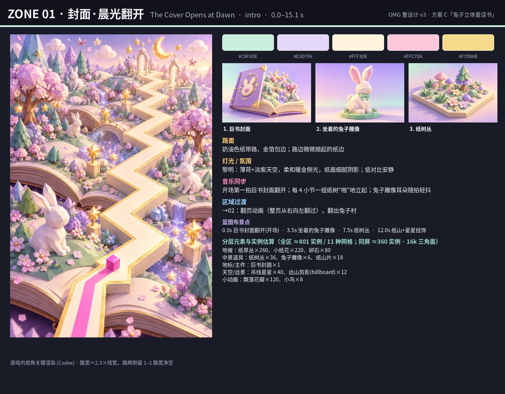

巨书在黎明翻开，薄荷淡紫纸山、纸树与兔子雕像，安静开场。

- **色板**：`#C9F0DE` `#E3D7FA` `#FFF3DE` `#FFC7DA` `#F7D98B`
- **路面**：奶油色纸带路，金箔包边；路边微微翘起的纸边
- **灯光/氛围**：黎明：薄荷+淡紫天空，柔和暖金侧光，纸面细腻阴影；低对比安静
- **主件细节渲染**：巨书封面、坐着的兔子雕像、纸树丛
- **分层元素**（全区 ≈801 实例，11 种网格；同屏 ≈360 实例 / 16k 三角面）：
  - 地被：纸草丛×260（24 面）、小纸花×220（30 面）、卵石×80（20 面）
  - 中景道具：纸树丛×36（320 面）、兔子雕像×6（600 面）、纸山片×18（120 面）
  - 地标/主件：巨书封面×1（4000 面）
  - 天空/远景：吊线星星×40（24 面）、远山剪影(billboard)×12（2 面）
  - 小动画：飘落花瓣×120（2 面）、小鸟×8（60 面）
- **蓝图布景点**：0.5s 全场/路面 巨书封面翻开(开场)；3.5s 路右 坐着的兔子雕像；7.5s 路左 纸树丛；12.0s 路右 纸山+星星挂饰
- **音乐同步**：开场第一拍巨书封面翻开；每 4 小节一组纸树“啪”地立起；兔子雕像耳朵随拍轻抖
- **过渡**：→02：翻页动画（整页从右向左翻过），翻出兔子村

### 02 · 第一章·兔子村（Chapter 1 · Bunny Village）— verse1，15.1–30.2 s

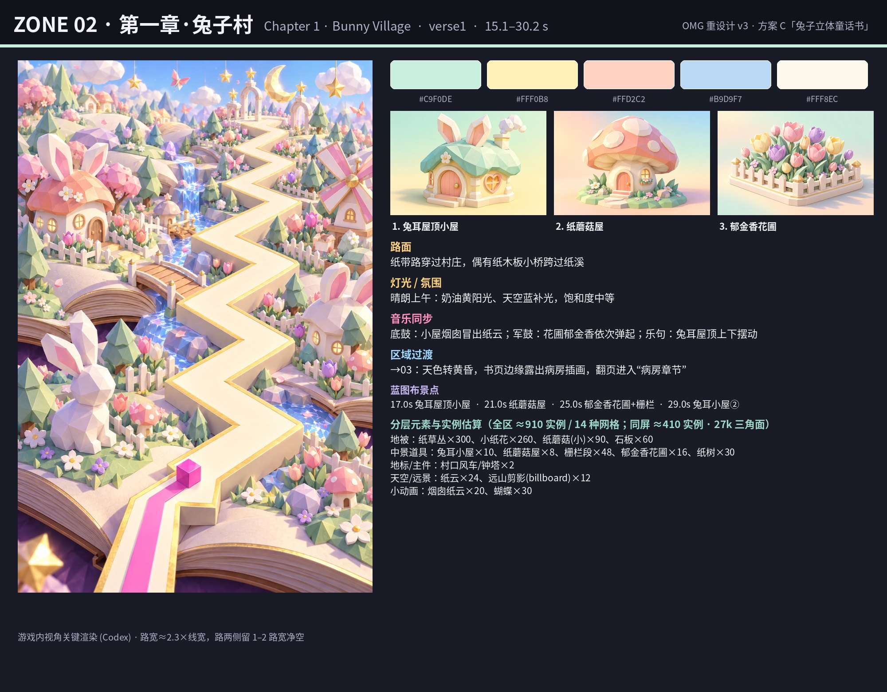

书的第一章：兔耳屋顶小屋、蘑菇屋、郁金香花圃的晴天兔子村，随鼓点冒纸云、弹花。

- **色板**：`#C9F0DE` `#FFF0B8` `#FFD2C2` `#B9D9F7` `#FFF8EC`
- **路面**：纸带路穿过村庄，偶有纸木板小桥跨过纸溪
- **灯光/氛围**：晴朗上午：奶油黄阳光、天空蓝补光，饱和度中等
- **主件细节渲染**：兔耳屋顶小屋、纸蘑菇屋、郁金香花圃
- **分层元素**（全区 ≈910 实例，14 种网格；同屏 ≈410 实例 / 27k 三角面）：
  - 地被：纸草丛×300（24 面）、小纸花×260（30 面）、纸蘑菇(小)×90（60 面）、石板×60（20 面）
  - 中景道具：兔耳小屋×10（900 面）、纸蘑菇屋×8（700 面）、栅栏段×48（60 面）、郁金香花圃×16（300 面）、纸树×30（320 面）
  - 地标/主件：村口风车/钟塔×2（3000 面）
  - 天空/远景：纸云×24（60 面）、远山剪影(billboard)×12（2 面）
  - 小动画：烟囱纸云×20（40 面）、蝴蝶×30（8 面）
- **蓝图布景点**：17.0s 路左 兔耳屋顶小屋；21.0s 路右 纸蘑菇屋；25.0s 路左 郁金香花圃+栅栏；29.0s 路右 兔耳小屋②
- **音乐同步**：底鼓：小屋烟囱冒出纸云；军鼓：花圃郁金香依次弹起；乐句：兔耳屋顶上下摆动
- **过渡**：→03：天色转黄昏，书页边缘露出病房插画，翻页进入“病房章节”

### 03 · 第二章·纸页病房（Chapter 2 · The Storybook Ward）— pre1，30.2–45.4 s

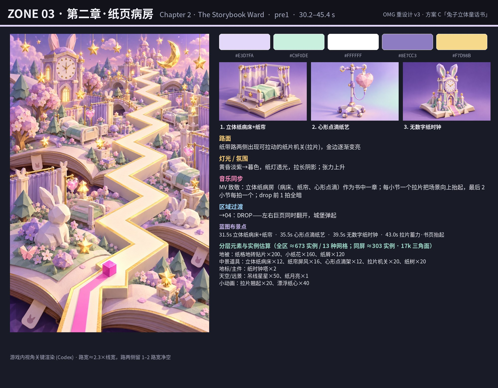

黄昏的“病房章节”（MV 致敬）：立体纸病床、心形点滴、无数字纸钟；拉片一节节抬起蓄力，drop 前一拍全暗。

- **色板**：`#E3D7FA` `#C9F0DE` `#FFFFFF` `#8E7CC3` `#F7D98B`
- **路面**：纸带路两侧出现可拉动的纸片机关(拉片)，金边逐渐变亮
- **灯光/氛围**：黄昏淡紫→暮色，纸灯透光，拉长阴影；张力上升
- **主件细节渲染**：立体纸病床+纸帘、心形点滴纸艺、无数字纸时钟
- **分层元素**（全区 ≈673 实例，13 种网格；同屏 ≈303 实例 / 17k 三角面）：
  - 地被：纸格地砖贴片×200（8 面）、小纸花×160（30 面）、纸屑×120（4 面）
  - 中景道具：立体纸病床×12（700 面）、纸帘屏风×16（200 面）、心形点滴架×12（260 面）、拉片机关×20（80 面）、纸树×20（320 面）
  - 地标/主件：纸时钟塔×2（2500 面）
  - 天空/远景：吊线星星×50（24 面）、纸月亮×1（200 面）
  - 小动画：拉片翘起×20（80 面）、漂浮纸心×40（12 面）
- **蓝图布景点**：31.5s 路左 立体纸病床+纸帘；35.5s 路右 心形点滴纸艺；39.5s 路左 无数字纸时钟；43.0s 全场/路面 拉片蓄力·书页抬起
- **音乐同步**：MV 致敬：立体纸病房（病床、纸帘、心形点滴）作为书中一章；每小节一个拉片把场景向上抬起，最后 2 小节每拍一个；drop 前 1 拍全暗
- **过渡**：→04：DROP——左右巨页同时翻开，城堡弹起

### 04 · 高潮①·弹出城堡之夜（Drop 1 · Pop-up Castle Night）— chorus1，45.4–60.5 s

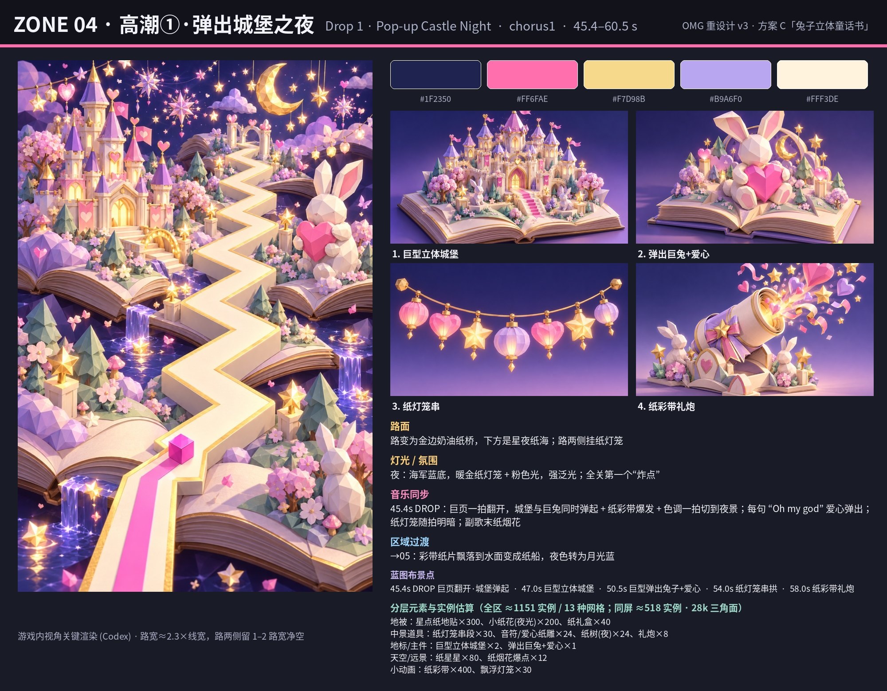

DROP①：巨页一拍翻开，巨型立体城堡和抱爱心的巨兔弹起，纸彩带爆发，色调切入夜景+纸灯笼。

- **色板**：`#1F2350` `#FF6FAE` `#F7D98B` `#B9A6F0` `#FFF3DE`
- **路面**：路变为金边奶油纸桥，下方是星夜纸海；路两侧挂纸灯笼
- **灯光/氛围**：夜：海军蓝底，暖金纸灯笼 + 粉色光，强泛光；全关第一个“炸点”
- **主件细节渲染**：巨型立体城堡、弹出巨兔+爱心、纸灯笼串、纸彩带礼炮
- **分层元素**（全区 ≈1151 实例，13 种网格；同屏 ≈518 实例 / 28k 三角面）：
  - 地被：星点纸地贴×300（8 面）、小纸花(夜光)×200（30 面）、纸礼盒×40（60 面）
  - 中景道具：纸灯笼串段×30（200 面）、音符/爱心纸雕×24（240 面）、纸树(夜)×24（320 面）、礼炮×8（300 面）
  - 地标/主件：巨型立体城堡×2（8000 面）、弹出巨兔+爱心×1（6000 面）
  - 天空/远景：纸星星×80（24 面）、纸烟花爆点×12（400 面）
  - 小动画：纸彩带×400（2 面）、飘浮灯笼×30（40 面）
- **蓝图布景点**：45.4s 全场/路面 DROP 巨页翻开·城堡弹起；47.0s 路右 巨型立体城堡；50.5s 路左 巨型弹出兔子+爱心；54.0s 全场/路面 纸灯笼串拱；58.0s 路右 纸彩带礼炮
- **音乐同步**：45.4s DROP：巨页一拍翻开，城堡与巨兔同时弹起 + 纸彩带爆发 + 色调一拍切到夜景；每句 “Oh my god” 爱心弹出；纸灯笼随拍明暗；副歌末纸烟花
- **过渡**：→05：彩带纸片飘落到水面变成纸船，夜色转为月光蓝

### 05 · 第三章·月光湖纸船（Chapter 3 · Moonlit Paper Lake）— post1，60.5–75.6 s

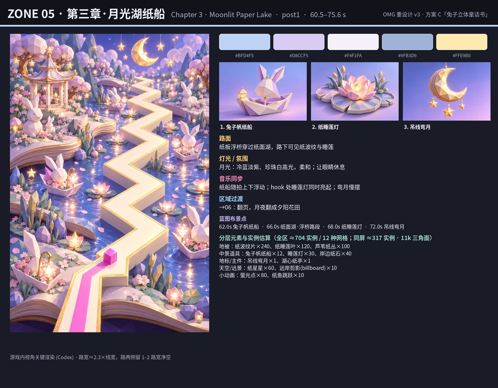

月光湖：兔子帆纸船、睡莲灯、吊线弯月，冷蓝淡紫的休息段。

- **色板**：`#BFD4F5` `#D8CCF5` `#F4F1FA` `#9FB3D9` `#FFE9B0`
- **路面**：纸板浮桥穿过纸面湖，路下可见纸波纹与睡莲
- **灯光/氛围**：月光：冷蓝淡紫、珍珠白高光，柔和；让眼睛休息
- **主件细节渲染**：兔子帆纸船、纸睡莲灯、吊线弯月
- **分层元素**（全区 ≈704 实例，12 种网格；同屏 ≈317 实例 / 11k 三角面）：
  - 地被：纸波纹片×240（8 面）、纸睡莲叶×120（24 面）、芦苇纸丛×100（40 面）
  - 中景道具：兔子帆纸船×12（400 面）、睡莲灯×30（120 面）、岸边纸石×40（60 面）
  - 地标/主件：吊线弯月×1（1200 面）、湖心纸亭×1（3000 面）
  - 天空/远景：纸星星×60（24 面）、远岸剪影(billboard)×10（2 面）
  - 小动画：萤光点×80（2 面）、纸鱼跳跃×10（40 面）
- **蓝图布景点**：62.0s 路右 兔子帆纸船；66.0s 全场/路面 纸面湖·浮桥路段；68.0s 路左 纸睡莲灯；72.0s 路右 吊线弯月
- **音乐同步**：纸船随拍上下浮动；hook 处睡莲灯同时亮起；弯月慢摆
- **过渡**：→06：翻页，月夜翻成夕阳花田

### 06 · 第四章·电话花田（Chapter 4 · Phone Flower Meadow）— verse2，75.6–90.7 s

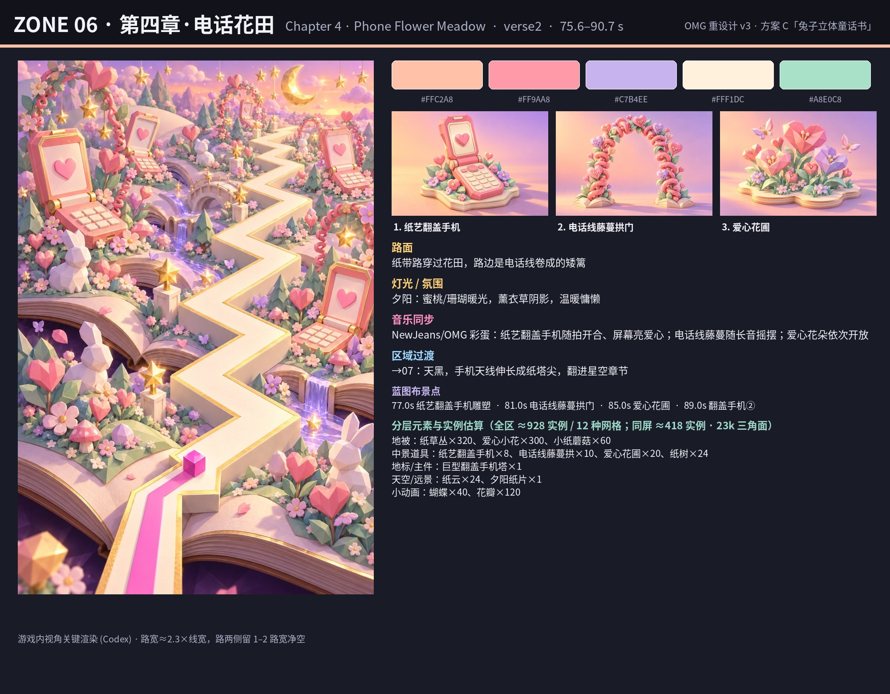

夕阳电话花田：纸艺翻盖手机随拍开合亮爱心，电话线藤蔓拱门，爱心花开（NewJeans/OMG 彩蛋）。

- **色板**：`#FFC2A8` `#FF9AA8` `#C7B4EE` `#FFF1DC` `#A8E0C8`
- **路面**：纸带路穿过花田，路边是电话线卷成的矮篱
- **灯光/氛围**：夕阳：蜜桃/珊瑚暖光，薰衣草阴影，温暖慵懒
- **主件细节渲染**：纸艺翻盖手机、电话线藤蔓拱门、爱心花圃
- **分层元素**（全区 ≈928 实例，12 种网格；同屏 ≈418 实例 / 23k 三角面）：
  - 地被：纸草丛×320（24 面）、爱心小花×300（30 面）、小纸蘑菇×60（60 面）
  - 中景道具：纸艺翻盖手机×8（900 面）、电话线藤蔓拱×10（500 面）、爱心花圃×20（300 面）、纸树×24（320 面）
  - 地标/主件：巨型翻盖手机塔×1（4000 面）
  - 天空/远景：纸云×24（60 面）、夕阳纸片×1（300 面）
  - 小动画：蝴蝶×40（8 面）、花瓣×120（2 面）
- **蓝图布景点**：77.0s 路左 纸艺翻盖手机雕塑；81.0s 路右 电话线藤蔓拱门；85.0s 路左 爱心花圃；89.0s 路右 翻盖手机②
- **音乐同步**：NewJeans/OMG 彩蛋：纸艺翻盖手机随拍开合、屏幕亮爱心；电话线藤蔓随长音摇摆；爱心花朵依次开放
- **过渡**：→07：天黑，手机天线伸长成纸塔尖，翻进星空章节

### 07 · 第五章·星空纸塔（Chapter 5 · Starry Paper Towers）— pre2，90.7–105.8 s

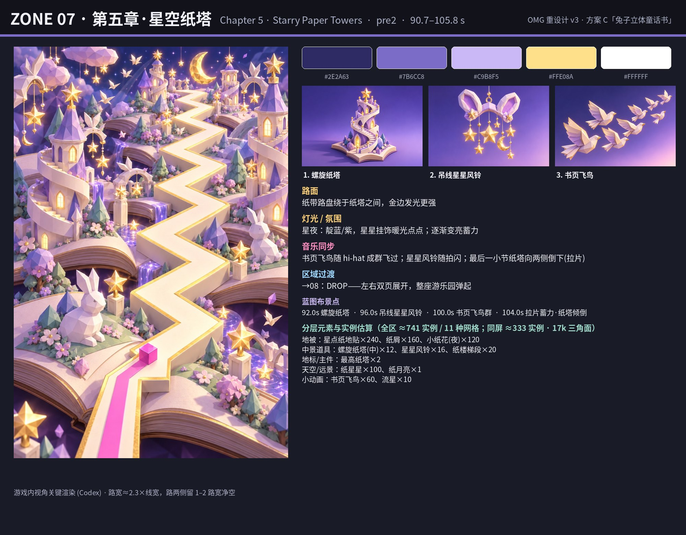

星夜纸塔：螺旋纸塔、星星风铃、书页飞鸟群向上飞，最后一节纸塔向两侧倒下蓄力。

- **色板**：`#2E2A63` `#7B6CC8` `#C9B8F5` `#FFE08A` `#FFFFFF`
- **路面**：纸带路盘绕于纸塔之间，金边发光更强
- **灯光/氛围**：星夜：靛蓝/紫，星星挂饰暖光点点；逐渐变亮蓄力
- **主件细节渲染**：螺旋纸塔、吊线星星风铃、书页飞鸟
- **分层元素**（全区 ≈741 实例，11 种网格；同屏 ≈333 实例 / 17k 三角面）：
  - 地被：星点纸地贴×240（8 面）、纸屑×160（4 面）、小纸花(夜)×120（30 面）
  - 中景道具：螺旋纸塔(中)×12（1200 面）、星星风铃×16（200 面）、纸楼梯段×20（160 面）
  - 地标/主件：最高纸塔×2（4000 面）
  - 天空/远景：纸星星×100（24 面）、纸月亮×1（200 面）
  - 小动画：书页飞鸟×60（16 面）、流星×10（20 面）
- **蓝图布景点**：92.0s 路右 螺旋纸塔；96.0s 路左 吊线星星风铃；100.0s 全场/路面 书页飞鸟群；104.0s 全场/路面 拉片蓄力·纸塔倾倒
- **音乐同步**：书页飞鸟随 hi-hat 成群飞过；星星风铃随拍闪；最后一小节纸塔向两侧倒下(拉片)
- **过渡**：→08：DROP——左右双页展开，整座游乐园弹起

### 08 · 高潮②·爱心嘉年华（Drop 2 · Heart Carnival Pop-up）— chorus2，105.8–121.0 s

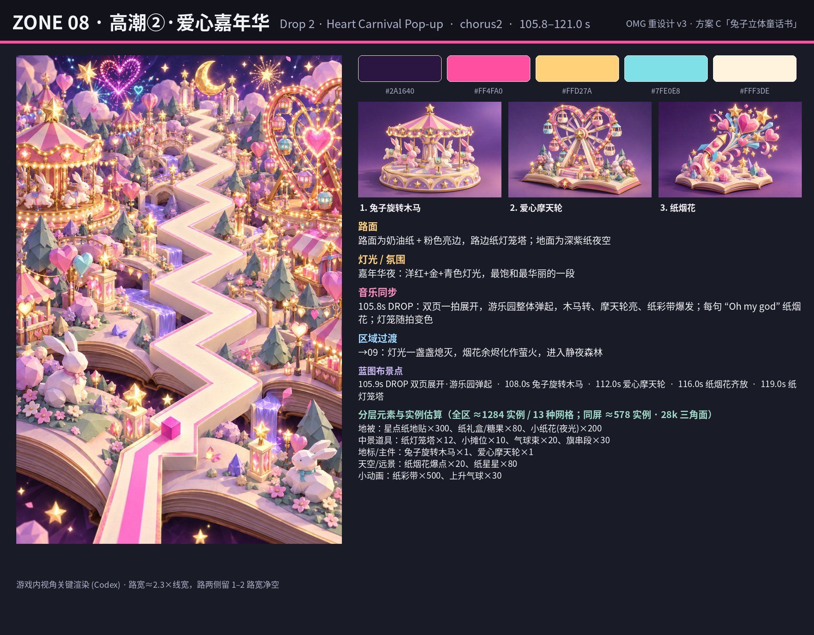

DROP②（全关最华丽）：双页展开，兔子旋转木马、爱心摩天轮、纸灯笼塔一起弹起，纸烟花随每句 “Oh my god” 炸开。

- **色板**：`#2A1640` `#FF4FA0` `#FFD27A` `#7FE0E8` `#FFF3DE`
- **路面**：路面为奶油纸 + 粉色亮边，路边纸灯笼塔；地面为深紫纸夜空
- **灯光/氛围**：嘉年华夜：洋红+金+青色灯光，最饱和最华丽的一段
- **主件细节渲染**：兔子旋转木马、爱心摩天轮、纸烟花
- **分层元素**（全区 ≈1284 实例，13 种网格；同屏 ≈578 实例 / 28k 三角面）：
  - 地被：星点纸地贴×300（8 面）、纸礼盒/糖果×80（60 面）、小纸花(夜光)×200（30 面）
  - 中景道具：纸灯笼塔×12（600 面）、小摊位×10（800 面）、气球束×20（200 面）、旗串段×30（60 面）
  - 地标/主件：兔子旋转木马×1（8000 面）、爱心摩天轮×1（8000 面）
  - 天空/远景：纸烟花爆点×20（400 面）、纸星星×80（24 面）
  - 小动画：纸彩带×500（2 面）、上升气球×30（40 面）
- **蓝图布景点**：105.9s 全场/路面 DROP 双页展开·游乐园弹起；108.0s 路右 兔子旋转木马；112.0s 路左 爱心摩天轮；116.0s 全场/路面 纸烟花齐放；119.0s 路右 纸灯笼塔
- **音乐同步**：105.8s DROP：双页一拍展开，游乐园整体弹起，木马转、摩天轮亮、纸彩带爆发；每句 “Oh my god” 纸烟花；灯笼随拍变色
- **过渡**：→09：灯光一盏盏熄灭，烟花余烬化作萤火，进入静夜森林

### 09 · 第六章·静夜森林（Chapter 6 · Quiet Paper Forest）— post2，121.0–151.2 s

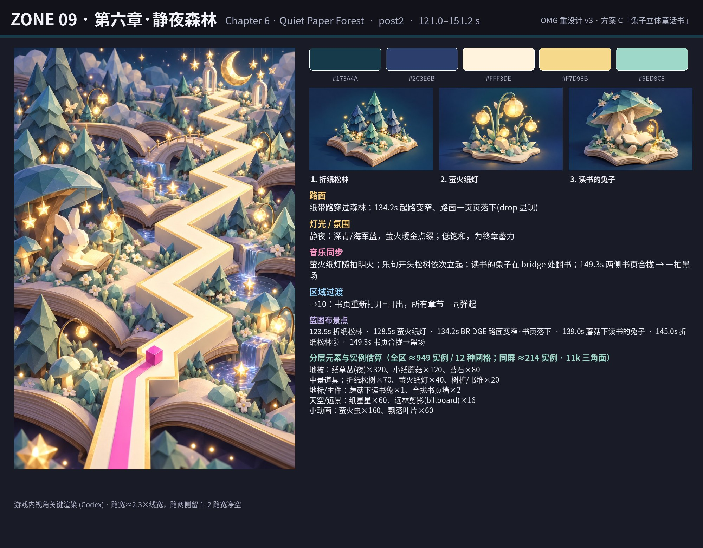

静夜折纸森林：萤火纸灯、蘑菇下读书的兔子；bridge 路面一页页落下，149.3s 书页合拢黑场。

- **色板**：`#173A4A` `#2C3E6B` `#FFF3DE` `#F7D98B` `#9ED8C8`
- **路面**：纸带路穿过森林；134.2s 起路变窄、路面一页页落下(drop 显现)
- **灯光/氛围**：静夜：深青/海军蓝，萤火暖金点缀；低饱和，为终章蓄力
- **主件细节渲染**：折纸松林、萤火纸灯、读书的兔子
- **分层元素**（全区 ≈949 实例，12 种网格；同屏 ≈214 实例 / 11k 三角面）：
  - 地被：纸草丛(夜)×320（24 面）、小纸蘑菇×120（60 面）、苔石×80（30 面）
  - 中景道具：折纸松树×70（260 面）、萤火纸灯×40（60 面）、树桩/书堆×20（200 面）
  - 地标/主件：蘑菇下读书兔×1（3000 面）、合拢书页墙×2（2000 面）
  - 天空/远景：纸星星×60（24 面）、远林剪影(billboard)×16（2 面）
  - 小动画：萤火虫×160（2 面）、飘落叶片×60（2 面）
- **蓝图布景点**：123.5s 路左 折纸松林；128.5s 路右 萤火纸灯；134.2s 全场/路面 BRIDGE 路面变窄·书页落下；139.0s 路左 蘑菇下读书的兔子；145.0s 路右 折纸松林②；149.3s 全场/路面 书页合拢→黑场
- **音乐同步**：萤火纸灯随拍明灭；乐句开头松树依次立起；读书的兔子在 bridge 处翻书；149.3s 两侧书页合拢 → 一拍黑场
- **过渡**：→10：书页重新打开=日出，所有章节一同弹起

### 10 · 终章·日出大团圆（Finale · Sunrise Grand Spread）— finale，151.2–160.6 s

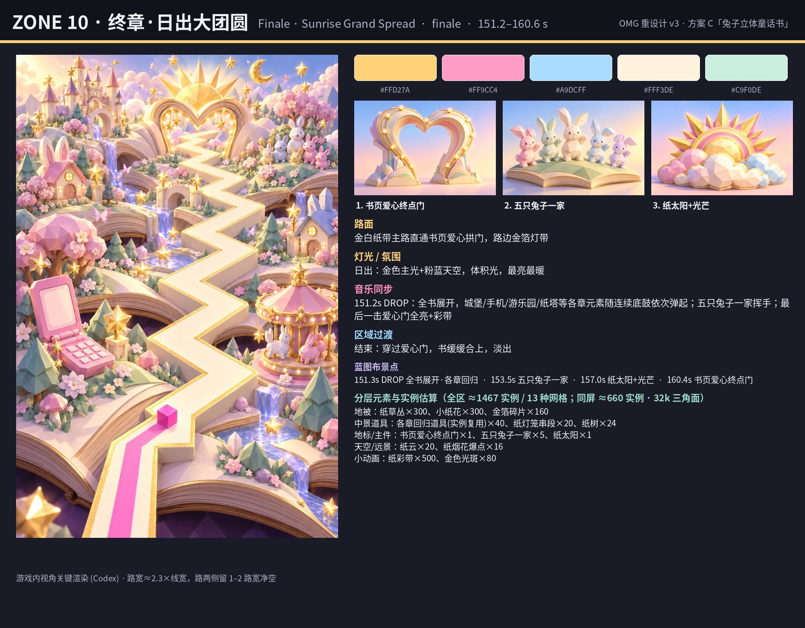

日出大团圆：全书展开，各章元素依次弹回，五只兔子一家挥手，路通向书页爱心终点门。

- **色板**：`#FFD27A` `#FF9CC4` `#A9DCFF` `#FFF3DE` `#C9F0DE`
- **路面**：金白纸带主路直通书页爱心拱门，路边金箔灯带
- **灯光/氛围**：日出：金色主光+粉蓝天空，体积光，最亮最暖
- **主件细节渲染**：书页爱心终点门、五只兔子一家、纸太阳+光芒
- **分层元素**（全区 ≈1467 实例，13 种网格；同屏 ≈660 实例 / 32k 三角面）：
  - 地被：纸草丛×300（24 面）、小纸花×300（30 面）、金箔碎片×160（4 面）
  - 中景道具：各章回归道具(实例复用)×40（600 面）、纸灯笼串段×20（200 面）、纸树×24（320 面）
  - 地标/主件：书页爱心终点门×1（5000 面）、五只兔子一家×5（1200 面）、纸太阳×1（1000 面）
  - 天空/远景：纸云×20（60 面）、纸烟花爆点×16（400 面）
  - 小动画：纸彩带×500（2 面）、金色光斑×80（2 面）
- **蓝图布景点**：151.3s 全场/路面 DROP 全书展开·各章回归；153.5s 路左 五只兔子一家；157.0s 路右 纸太阳+光芒；160.4s 全场/路面 书页爱心终点门
- **音乐同步**：151.2s DROP：全书展开，城堡/手机/游乐园/纸塔等各章元素随连续底鼓依次弹起；五只兔子一家挥手；最后一击爱心门全亮+彩带
- **过渡**：结束：穿过爱心门，书缓缓合上，淡出

---

## 4. 路线蓝图

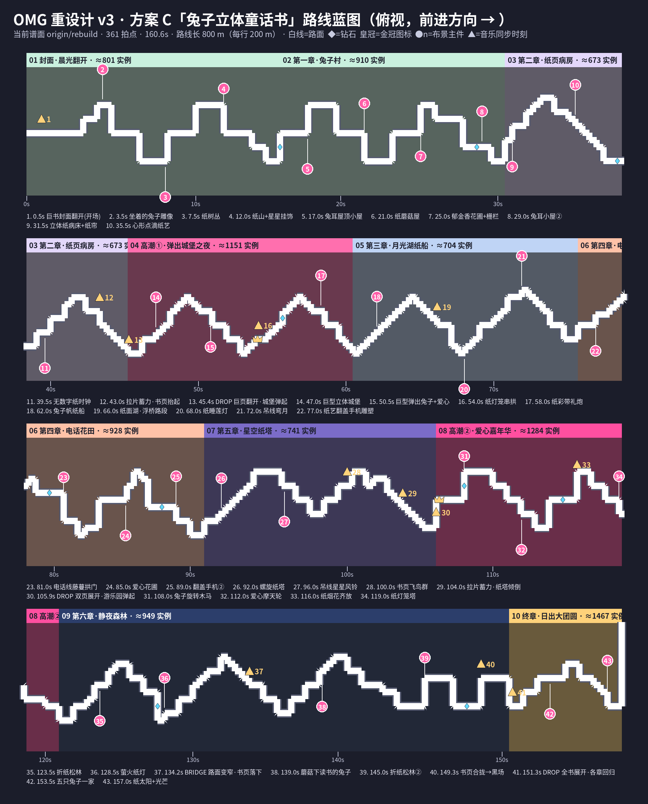

俯视全路线（800 m，四行各 200 m，前进方向向右）。底色=章节区域（标注全区实例估算）；粉色圆点=路侧主件（距路中心约 12 m）；金色三角=音乐同步/弹出时刻；蓝色菱形=钻石；金冠=皇冠。所有布景按时间 t + 左右侧定义，**相对路线生成**，换谱后自动重算；地被/中景按路线两侧条带随机撒点并用 RoadGrid 推开。

---

## 5. 性能方案（目标：中端手机 60 fps）

**预算（每帧可见）**：draw call < 150；可见三角面 < 300k；透明/叠加层 overdraw 控制在全屏 ≤ 2 层；粒子同屏 ≤ 800；纹理总量 ≤ 24 MB（压缩后）。

| 项 | 做法 |
|---|---|
| 网格 | 全部低多边形（地被 8–60 面、中景 60–1200 面、主件 2k–8k 面），平面着色，纸艺折面用几何表现而不是贴图 |
| 实例化 | 每种重复元素 = 1 个网格 + thin instance（矩阵 + 颜色），一种元素一次 draw call；全关约 120 种网格，单区同屏 11–14 种 |
| 材质/贴图 | 统一 1 张 2048² 纸纹+色板图集（texture atlas），颜色用**顶点色/实例色**；全关 ≤ 6 个材质（纸-不透明、纸-自发光、纸-alpha test、粒子、路、天空） |
| 静态合并 | 不动的地被与小道具按 **每 20 m 路段一块 chunk** 合并（mergeMeshes），冻结世界矩阵/材质 |
| 光照 | **烘焙**：顶点色里带环境光遮蔽与渐变，取消实时阴影；只保留 1 个方向光 + 半球光；地标脚下用一张假阴影贴片 |
| LOD / billboard | 主件 2 级 LOD（> 35 m 换 30% 面数）；天空与远景（> 40 m）一律 billboard 或合并为远景片；粒子远处减量 |
| 流式与剔除 | 沿路线分块，只激活 [当前 t − 3 s, t + 6 s] 的 chunk（≈90 m），进入时弹出动画、离开后回收到对象池；视锥剔除按 chunk 包围盒；零每帧分配 |
| 动画 | 弹出/摆动/开合全部在顶点着色器或实例矩阵里做（按拍子 uniform），不走骨骼；节拍只更新少量 uniform |
| 质量档 | high：全部层；low：地被密度 ×0.5、粒子 ×0.4、关闭泛光、远景只用一张片 |

**估算（同屏）**：
- 实例：≈200–660（见区域速览表；z10 最多 ≈660），区域交界处两区同屏时上限 ≈1100。
- 三角面：≈11k–33k（交界 ≈60k），远低于 300k，余量可用来加厚折纸细节或增加地被密度 ×2–3。
- draw call：地被 3–4 + 中景 4–6 + 地标 2–3 + 天空 2 + 粒子 2 + 路/地面/天空盒 ≈5 → 单区 ≈20–25；交界两区 ≈45；加泛光/后处理 ≈10 → **≈55，远低于 150**。
- 对比现在：现版 OMG 主要是平面立牌 + 少量方块；方案 C 在同等甚至更低的 draw call 下，同屏元素数量约为现在的 5–10 倍。

---

## 6. 待你确认
1. 十个章节的主题/顺序是否 OK（例如第四章电话花田、第二章病房章节的程度）？
2. 两次 DROP 的“巨页翻开 + 弹出”是否够炸，还想加什么（例如巨兔跳到路上方、镜头短暂拉远）？
3. 密度：效果图的密度是否就是你想要的（可以再加/再减）？
