# OMG 地图重设计 v3（设计稿，待确认）

> 状态：**仅设计，不改游戏代码**。确认方案后再进入建模/实现。
> 路线：origin/rebuild 当前谱面（你的点击，361 拍点，160.6 s 结束，前进式折线路线，路宽 2.2→2.0→1.8 m ≈ 2.2–2.5 倍线宽）。
> 所有渲染图均由 Codex（Mac mini，gpt-6.1-sol，high）生成；是**设计效果图**，不是最终贴图——实现时用真正的低多边形 3D 网格搭建。

交付物：
- 总览板：`deliverables/omg-redesign/board.jpg`（三个概念 + 推荐方案的十个区域）
- 区域设计稿：`deliverables/omg-redesign/zones-z01-intro.jpg` … `zones-z10-finale.jpg`
- 路线蓝图：`deliverables/omg-redesign/blueprint.png`
- 原始渲染：`levels-design/omg/redesign-v3/renders/`（Codex 提示词见 `prompts/`）
- 数据/脚本：`zones_v3.py`（区域、色板、布景点）、`blueprint.py`、`sheets.py`、`make_doc.py`

---

## 1. 调研：原版跳舞的线为什么好看

1. **低多边形“微缩模型”世界**：场景基本由方块和少量定制模型拼成，平涂/少量渐变材质、无复杂贴图，靠清晰轮廓和体积取胜（参考：Unity 论坛对其制作方式的分析 [1]；低多边形美术要点：干净剪影、有限色板、简单方向光 [3]）。
2. **一关一个完整主题世界**：每首歌对应一个原型场景（冬天、农田、天空、海洋、钢琴…），所有物件都服务于这个主题，所以看起来“统一”而不是“堆贴纸”[2][5]。
3. **随音乐分段换景、换色**：到达检查点/乐段时，颜色、灯光、物件形状和氛围一起变化；《The Earth》从明亮绿野转向被砍伐的工地，音乐同时变暗，叙事感很强 [2][4]。
4. **路本身就是世界的一部分**：路会变成桥、栈道、石阶、屋顶、悬崖边；在后段甚至变色/变窄来提示难度（如《混沌》The Chaos 60% 处路由黄变砖红并变窄 [6]）。
5. **布景动画=音乐可视化**：物件从地下升起、倒下、塌落、翻开、发光、随拍跳动；关键鼓点有大动作（drop 爆发），安静段落只有少量轻动作。
6. **光与雾**：单一主方向光 + 柔和阴影 + 远景雾/渐变底色，把视线集中到路与线头上；前景路面亮度/饱和度永远最高。
7. **克制的密度**：近处干净、远处有大轮廓；“华丽”来自大型主件与整体色调变化，而不是满屏小物件。

参考：
[1] Unity Discussions “How do they make this?” https://discussions.unity.com/t/how-do-they-make-this/652016
[2] Reading Eagle, “Graphics and music morph into tricky ‘Dancing Line’” (2017) https://www.readingeagle.com/2017/08/29/graphics-and-music-morph-into-tricky-dancing-line/
[3] RetroStyle Games, “Low Poly Game Art: An Ultimate Guide” https://retrostylegames.com/blog/low-poly-game-art-an-ultimate-guide/
[4] NoobFeed, Dancing Line Review https://www.noobfeed.com/reviews/dancing-line-review
[5] Baidu Baike (EN), Dancing Line 关卡列表 https://baike.baidu.com/en/item/Dancing%20Line/1460178
[6] NamuWiki, 혼돈(Dancing Line) 条目 https://en.namu.wiki/w/%ED%98%BC%EB%8F%88(Dancing%20Line)

**由此得出的设计原则**（v3 全部遵守）：
- 立体雕刻感低多边形网格（圆角倒角、平面着色），**不用平面贴纸立牌**。
- 每区 3–5 色的限定色板；区与区之间做“颜色+地形+路面材质”三重变化。
- 路面始终是最亮、最干净的元素；布景只在路两侧，近路 2 m 内不放高物件，远处放大主件。
- 每区 1 个“主件”（hero set piece）+ 2–3 种重复配件，宁少勿乱。
- 音乐同步：drop 有一个大动作，乐句有中动作，拍子只做小动作（亮灯/轻跳）。

---

## 2. 三个整体概念

| 方案 | 一句话 | 优点 | 风险 |
|---|---|---|---|
| **A 粉彩病院·五个白日梦（推荐）** | 以粉彩低多边形病院为底色，沿路墙板像立体书一样翻开，依次进入病人们的白日梦：黑兔舞台、玻璃鞋宫殿、猫咪屋顶、翻盖手机桥、Y2K 屏幕城、童话书页，最后五面主题墙在日出舞台合体。 | 直接对应 MV（精神病院喜剧、每人一个幻想、手机、玻璃鞋、猫、书）；十个区域变化最丰富又有统一母题“病院→幻想”；路面材质每区可变（地砖→T台→玻璃桥→屋脊→手机桥→屏幕砖→书页） | 资产量最大，需要严格控制每区资产数（每区 1 主件 + 2–3 配件） |
| B 翻盖手机宇宙 | 整关在一部 Y2K 翻盖手机内部：电路板地形、按键广场、电容塔、屏幕天空；路是发光电路走线。 | 风格极统一，实现简单（几何感强） | 十个区域容易“长得一样”；与 MV 病院叙事关系弱 |
| C 兔子立体童话书 | 从巨大书页中弹出的纸艺低多边形花园：纸山、纸树、兔子雕像、纸月亮，路是奶油色纸带。 | 温柔、漂亮、低多边形折纸感天然适合 | 偏安静，副歌不够“炸”；与病院/手机主题关联弱 |

推荐 **A**：它把 MV 的核心梗（病房里的每个人都活在自己的幻想里）变成关卡结构——每到一个乐段，“病房墙板翻开”就是换景动画本身，非常像原版跳舞的线“随音乐整块变换世界”的做法。B 的手机元素与 C 的书页/猫元素都被吸收进 A 的单独区域里。

统一规则（方案 A）：
- 母题：白色/薄荷色病院地砖 + 金色细边，在每个区域都以某种形式出现（墙板、地砖边、终点五面墙之一）。
- 两次副歌（黑兔舞台、屏幕城）是全关最亮、最饱和的两段；中间区域（玻璃鞋、屋顶、书页）降低对比，给耳朵与眼睛休息。
- 线头/路面：路面为浅色高亮材质 + 发光包边，所有区域路面亮度高于地面至少 2 档。

---

## 3. 区域设计（方案 A）

区间与谱面对应（谱面原分段标签在括号内）：
intro 0–15.1（病房走廊）· verse1 15.1–30.3（治疗桌与五椅）· pre1 30.3–45.4（墙板外折）· chorus1 45.4–60.5（黑兔舞台）· post1 60.5–75.6（玻璃鞋）· verse2 75.6–90.7（双折长短路）· pre2 90.7–105.8（手机桥）· chorus2 105.8–121.0（屏幕块）· post2 121.0–151.2（错列直角 + 书页墙与猫 + 书页合拢）· finale 151.2–160.6（舞台五墙）。

### 01 · 晨雾病房（Morning Ward on the Mist Lake）— intro，0.0–15.1 s

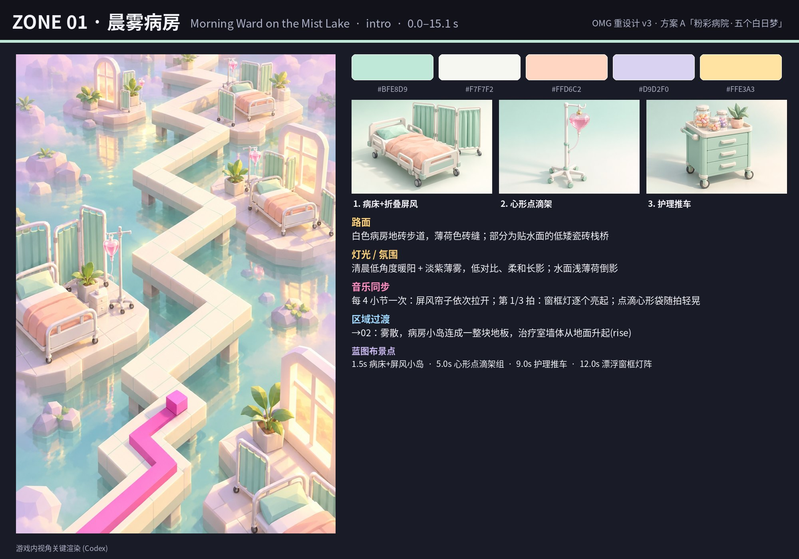

- **色板**：`#BFE8D9` `#F7F7F2` `#FFD6C2` `#D9D2F0` `#FFE3A3`
- **路面**：白色病房地砖步道，薄荷色砖缝；部分为贴水面的低矮瓷砖栈桥
- **灯光/氛围**：清晨低角度暖阳 + 淡紫薄雾，低对比、柔和长影；水面浅薄荷倒影
- **主要布景（细节渲染）**：病床+折叠屏风、心形点滴架、护理推车
- **蓝图布景点**：1.5s 路右 病床+屏风小岛；5.0s 路左 心形点滴架组；9.0s 路右 护理推车；12.0s 路左 漂浮窗框灯阵
- **音乐同步**：每 4 小节一次：屏风帘子依次拉开；第 1/3 拍：窗框灯逐个亮起；点滴心形袋随拍轻晃
- **过渡**：→02：雾散，病房小岛连成一整块地板，治疗室墙体从地面升起(rise)

### 02 · 团体治疗室（Group Therapy Circle）— verse1，15.1–30.2 s

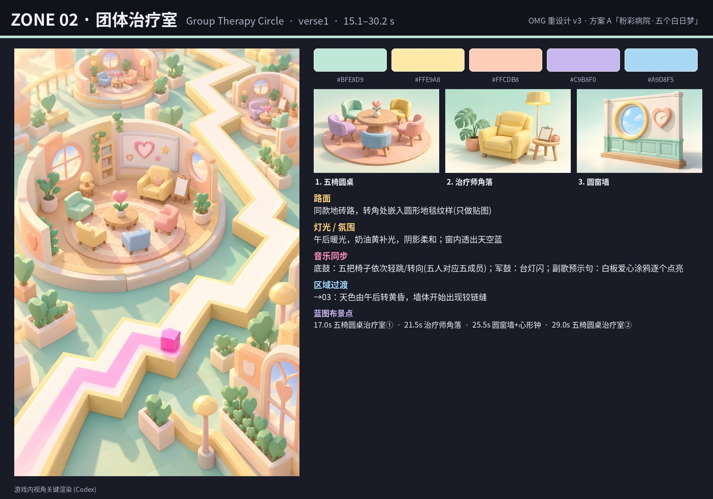

- **色板**：`#BFE8D9` `#FFE9A8` `#FFCDB8` `#C9B8F0` `#A9D8F5`
- **路面**：同款地砖路，转角处嵌入圆形地毯纹样(只做贴图)
- **灯光/氛围**：午后暖光，奶油黄补光，阴影柔和；窗内透出天空蓝
- **主要布景（细节渲染）**：五椅圆桌、治疗师角落、圆窗墙
- **蓝图布景点**：17.0s 路左 五椅圆桌治疗室①；21.5s 路右 治疗师角落；25.5s 路左 圆窗墙+心形钟；29.0s 路右 五椅圆桌治疗室②
- **音乐同步**：底鼓：五把椅子依次轻跳/转向(五人对应五成员)；军鼓：台灯闪；副歌预示句：白板爱心涂鸦逐个点亮
- **过渡**：→03：天色由午后转黄昏，墙体开始出现铰链缝

### 03 · 墙板外折（Folding Walls）— pre1，30.2–45.4 s

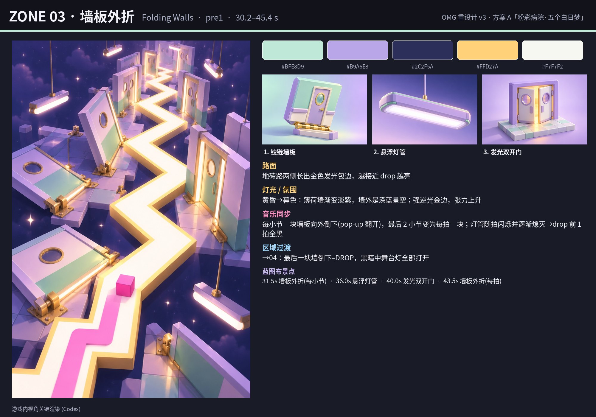

- **色板**：`#BFE8D9` `#B9A6E8` `#2C2F5A` `#FFD27A` `#F7F7F2`
- **路面**：地砖路两侧长出金色发光包边，越接近 drop 越亮
- **灯光/氛围**：黄昏→暮色：薄荷墙渐变淡紫，墙外是深蓝星空；强逆光金边，张力上升
- **主要布景（细节渲染）**：铰链墙板、悬浮灯管、发光双开门
- **蓝图布景点**：31.5s 全场/路面 墙板外折(每小节)；36.0s 路左 悬浮灯管；40.0s 路右 发光双开门；43.5s 全场/路面 墙板外折(每拍)
- **音乐同步**：每小节一块墙板向外倒下(pop-up 翻开)，最后 2 小节变为每拍一块；灯管随拍闪烁并逐渐熄灭→drop 前 1 拍全黑
- **过渡**：→04：最后一块墙倒下=DROP，黑暗中舞台灯全部打开

### 04 · 黑兔舞台（Black Bunny Stage）— chorus1，45.4–60.5 s

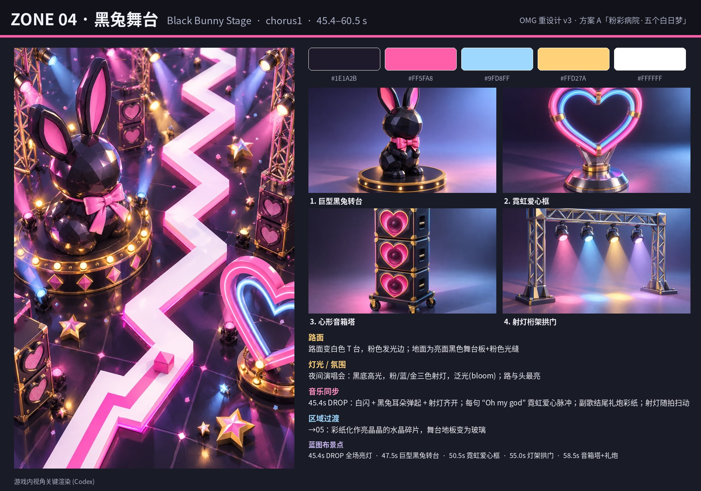

- **色板**：`#1E1A2B` `#FF5FA8` `#9FD8FF` `#FFD27A` `#FFFFFF`
- **路面**：路面变白色 T 台，粉色发光边；地面为亮面黑色舞台板+粉色光缝
- **灯光/氛围**：夜间演唱会：黑底高光，粉/蓝/金三色射灯，泛光(bloom)；路与头最亮
- **主要布景（细节渲染）**：巨型黑兔转台、霓虹爱心框、心形音箱塔、射灯桁架拱门
- **蓝图布景点**：45.4s 全场/路面 DROP 全场亮灯；47.5s 路右 巨型黑兔转台；50.5s 路左 霓虹爱心框；55.0s 全场/路面 灯架拱门；58.5s 路左 音箱塔+礼炮
- **音乐同步**：45.4s DROP：白闪 + 黑兔耳朵弹起 + 射灯齐开；每句 “Oh my god” 霓虹爱心脉冲；副歌结尾礼炮彩纸；射灯随拍扫动
- **过渡**：→05：彩纸化作亮晶晶的水晶碎片，舞台地板变为玻璃

### 05 · 玻璃鞋宫殿（Glass Slipper Palace）— post1，60.5–75.6 s

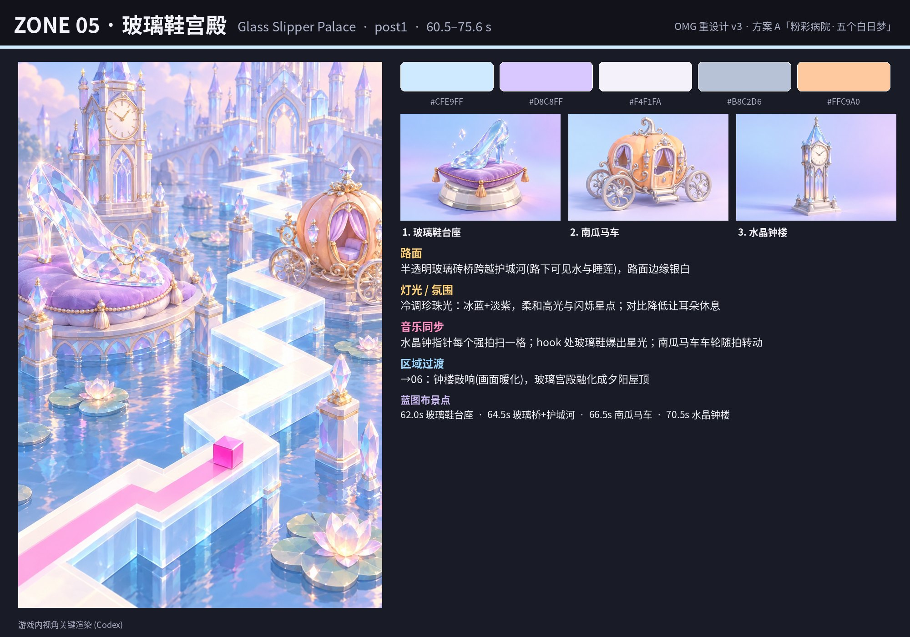

- **色板**：`#CFE9FF` `#D8C8FF` `#F4F1FA` `#B8C2D6` `#FFC9A0`
- **路面**：半透明玻璃砖桥跨越护城河(路下可见水与睡莲)，路面边缘银白
- **灯光/氛围**：冷调珍珠光：冰蓝+淡紫，柔和高光与闪烁星点；对比降低让耳朵休息
- **主要布景（细节渲染）**：玻璃鞋台座、南瓜马车、水晶钟楼
- **蓝图布景点**：62.0s 路右 玻璃鞋台座；64.5s 全场/路面 玻璃桥+护城河；66.5s 路左 南瓜马车；70.5s 路右 水晶钟楼
- **音乐同步**：水晶钟指针每个强拍扫一格；hook 处玻璃鞋爆出星光；南瓜马车车轮随拍转动
- **过渡**：→06：钟楼敲响(画面暖化)，玻璃宫殿融化成夕阳屋顶

### 06 · 猫咪屋顶（Cat Rooftops at Dusk）— verse2，75.6–90.7 s

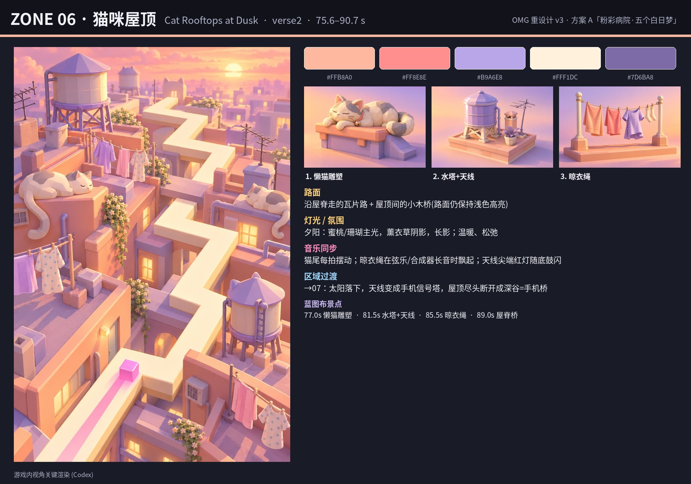

- **色板**：`#FFB8A0` `#FF8E8E` `#B9A6E8` `#FFF1DC` `#7D6BA8`
- **路面**：沿屋脊走的瓦片路 + 屋顶间的小木桥(路面仍保持浅色高亮)
- **灯光/氛围**：夕阳：蜜桃/珊瑚主光，薰衣草阴影，长影；温暖、松弛
- **主要布景（细节渲染）**：懒猫雕塑、水塔+天线、晾衣绳
- **蓝图布景点**：77.0s 路左 懒猫雕塑；81.5s 路右 水塔+天线；85.5s 路左 晾衣绳；89.0s 路右 屋脊桥
- **音乐同步**：猫尾每拍摆动；晾衣绳在弦乐/合成器长音时飘起；天线尖端红灯随底鼓闪
- **过渡**：→07：太阳落下，天线变成手机信号塔，屋顶尽头断开成深谷=手机桥

### 07 · 翻盖手机桥（Flip-Phone Bridge）— pre2，90.7–105.8 s

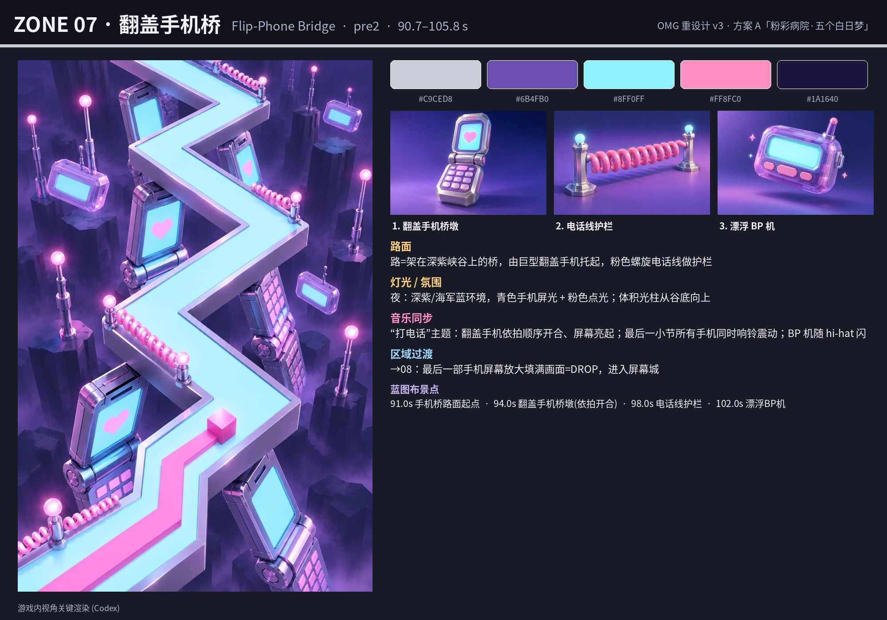

- **色板**：`#C9CED8` `#6B4FB0` `#8FF0FF` `#FF8FC0` `#1A1640`
- **路面**：路=架在深紫峡谷上的桥，由巨型翻盖手机托起，粉色螺旋电话线做护栏
- **灯光/氛围**：夜：深紫/海军蓝环境，青色手机屏光 + 粉色点光；体积光柱从谷底向上
- **主要布景（细节渲染）**：翻盖手机桥墩、电话线护栏、漂浮 BP 机
- **蓝图布景点**：91.0s 全场/路面 手机桥路面起点；94.0s 路右 翻盖手机桥墩(依拍开合)；98.0s 路左 电话线护栏；102.0s 路右 漂浮BP机
- **音乐同步**：“打电话”主题：翻盖手机依拍顺序开合、屏幕亮起；最后一小节所有手机同时响铃震动；BP 机随 hi-hat 闪
- **过渡**：→08：最后一部手机屏幕放大填满画面=DROP，进入屏幕城

### 08 · Y2K 屏幕城（Screen City）— chorus2，105.8–121.0 s

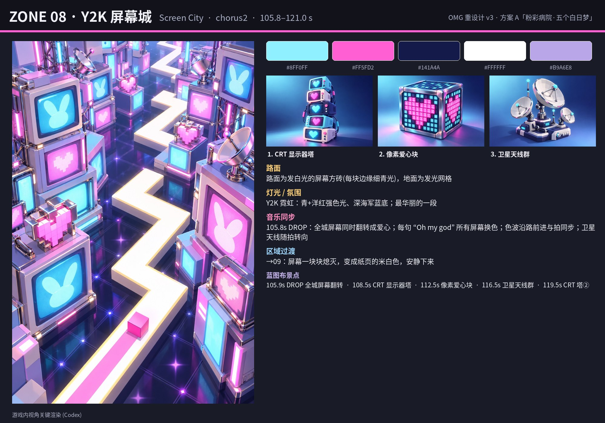

- **色板**：`#8FF0FF` `#FF5FD2` `#141A4A` `#FFFFFF` `#B9A6E8`
- **路面**：路面为发白光的屏幕方砖(每块边缘细青光)，地面为发光网格
- **灯光/氛围**：Y2K 霓虹：青+洋红强色光、深海军蓝底；最华丽的一段
- **主要布景（细节渲染）**：CRT 显示器塔、像素爱心块、卫星天线群
- **蓝图布景点**：105.9s 全场/路面 DROP 全城屏幕翻转；108.5s 路右 CRT 显示器塔；112.5s 路左 像素爱心块；116.5s 路右 卫星天线群；119.5s 路左 CRT 塔②
- **音乐同步**：105.8s DROP：全城屏幕同时翻转成爱心；每句 “Oh my god” 所有屏幕换色；色波沿路前进与拍同步；卫星天线随拍转向
- **过渡**：→09：屏幕一块块熄灭，变成纸页的米白色，安静下来

### 09 · 童话书页与猫（Storybook Pages & the Cat）— post2，121.0–151.2 s

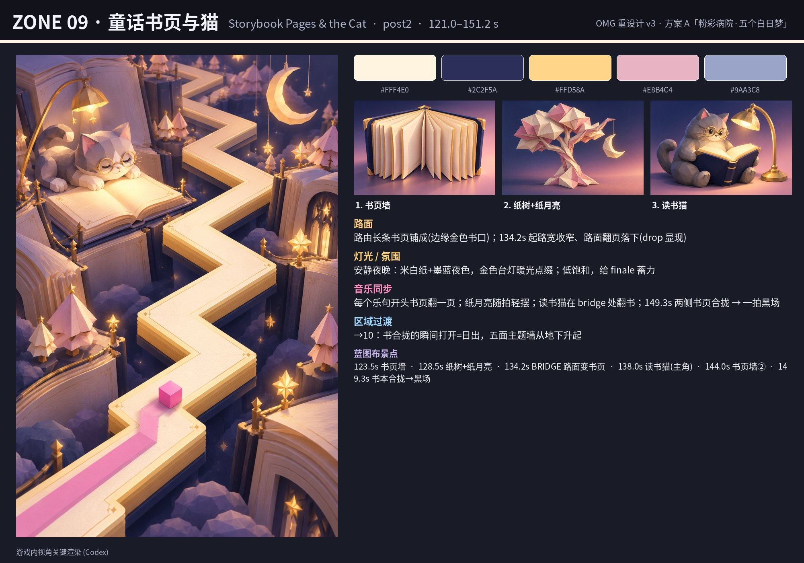

- **色板**：`#FFF4E0` `#2C2F5A` `#FFD58A` `#E8B4C4` `#9AA3C8`
- **路面**：路由长条书页铺成(边缘金色书口)；134.2s 起路宽收窄、路面翻页落下(drop 显现)
- **灯光/氛围**：安静夜晚：米白纸+墨蓝夜色，金色台灯暖光点缀；低饱和，给 finale 蓄力
- **主要布景（细节渲染）**：书页墙、纸树+纸月亮、读书猫
- **蓝图布景点**：123.5s 路左 书页墙；128.5s 路右 纸树+纸月亮；134.2s 全场/路面 BRIDGE 路面变书页；138.0s 路左 读书猫(主角)；144.0s 路右 书页墙②；149.3s 全场/路面 书本合拢→黑场
- **音乐同步**：每个乐句开头书页翻一页；纸月亮随拍轻摆；读书猫在 bridge 处翻书；149.3s 两侧书页合拢 → 一拍黑场
- **过渡**：→10：书合拢的瞬间打开=日出，五面主题墙从地下升起

### 10 · 五墙大舞台·日出（Five-Wall Grand Stage at Sunrise）— finale，151.2–160.6 s

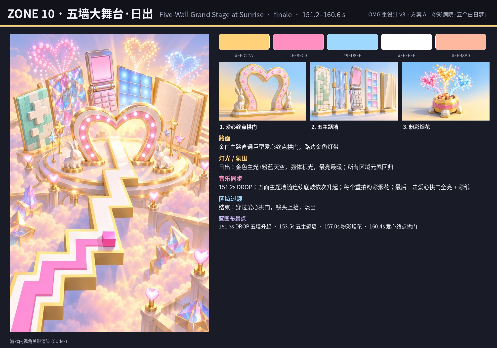

- **色板**：`#FFD27A` `#FF8FC0` `#9FD8FF` `#FFFFFF` `#FFB8A0`
- **路面**：金白主路直通巨型爱心终点拱门，路边金色灯带
- **灯光/氛围**：日出：金色主光+粉蓝天空，强体积光，最亮最暖；所有区域元素回归
- **主要布景（细节渲染）**：爱心终点拱门、五主题墙、粉彩烟花
- **蓝图布景点**：151.3s 全场/路面 DROP 五墙升起；153.5s 路左 五主题墙；157.0s 路右 粉彩烟花；160.4s 全场/路面 爱心终点拱门
- **音乐同步**：151.2s DROP：五面主题墙随连续底鼓依次升起；每个重拍粉彩烟花；最后一击爱心拱门全亮 + 彩纸
- **过渡**：结束：穿过爱心拱门，镜头上抬，淡出

---

## 4. 路线蓝图

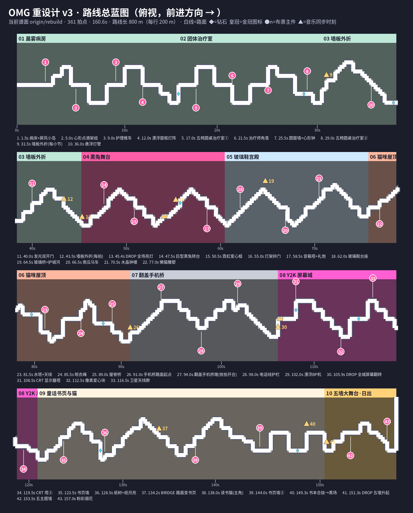

俯视全路线（800 m，按 200 m 分四行，前进方向向右）。底色=区域；粉色圆点=路侧主件（距路中心约 12 m，实现时按 RoadGrid 推开保证不压路）；金色三角=音乐同步时刻/路面变化；蓝色菱形=钻石；金冠=皇冠检查点。布景点全部按时间 t + 左右侧定义，**相对路线生成**，换谱后自动重算。

## 5. 实现备注（确认后再做）

- 每区：1 个主件（可动画的低多边形模型）+ 2–3 种配件实例化（thin instance），配件沿路两侧按节拍间距重复。
- 材质：平面着色 StandardMaterial/PBR 低光泽，少量自发光（霓虹、屏幕、灯）；色板驱动。
- 换景：沿用 reveal（rise/unfold/drop）+ 区域边界的“墙板翻开”动画；颜色通过雾/环境光/地面渐变过渡 1–2 s。
- 性能：每区同屏不超过 ~12 个主件实例 + 配件，静态网格冻结；不遮挡路面（沿用前方路线遮挡回避）。
- 待你确认：① 选 A/B/C；② 十个区域主题是否要替换某几个（例如屋顶猫 ↔ 别的 MV 元素）；③ 色调整体偏亮(白天) 还是偏夜景。
